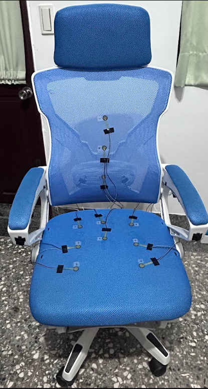

# 智慧座椅（Smart Chair）— 感測與提醒系統

在一般辦公椅上加裝 11 顆壓力感測器、4 顆震動馬達與 2 條 LED 燈條，由 ESP32 即時判斷坐姿與久坐時間：

- **坐姿不良**（前傾、後仰、左右傾）持續 10 秒以上 → 對應位置的馬達震動提醒，越久震越久
- **連續坐滿 30 分鐘** → 四顆馬達一起震動、燈條變紅閃爍，提醒起身活動
- **LED 燈條**：顏色表示久坐時間（綠 → 黃 → 紅），亮度表示重心偏向
- 所有資料透過 **MQTT** 傳給後端，斷網時震動與燈條照常運作

本文件說明材料、接線、安裝、燒錄、校正與驗證步驟，依照步驟應可做出相同的系統。

---

## 目錄

1. [系統架構](#1-系統架構)
2. [材料清單](#2-材料清單)
3. [電路與接線](#3-電路與接線)
4. [安裝到椅子](#4-安裝到椅子)
5. [軟體環境](#5-軟體環境)
6. [燒錄韌體](#6-燒錄韌體)
7. [感測器校正](#7-感測器校正)
8. [執行 demo](#8-執行-demo)
9. [功能規格](#9-功能規格)
10. [驗證與測試](#10-驗證與測試)
11. [可調參數](#11-可調參數)
12. [疑難排解](#12-疑難排解)
13. [檔案說明](#13-檔案說明)

---

## 1. 系統架構

```text
 11 × FSR 壓力感測器 ──► 3 × ADS1115（I²C）──┐
                                              ├──► ESP32 ──► 4 × 震動馬達（NPN 驅動）
 電池電壓分壓 ──────────────► GPIO36（VP）──┘      │  └──► 2 × WS2812B 燈條
                                                    │
                                                    └──WiFi / MQTT（TLS）──► 後端、pose_demo.py
```

ESP32 使用雙核心分工，網路斷線不會影響提醒功能：

| 核心 | 工作 |
|---|---|
| Core 1 | 感測器取樣（25 Hz）→ 坐姿判斷 → 震動提醒 → 久坐計時 → LED 燈條 |
| Core 0 | WiFi／MQTT 連線、送出資料、接收指令、OTA 燒錄 |

---

## 2. 材料清單

| 項目 | 規格 | 數量 | 用途 |
|---|---|---|---|
| 微控制器 | ESP32 DevKit（ESP32-WROOM-32，30 pin） | 1 | 主控、WiFi |
| 類比數位轉換器 | ADS1115 16-bit I²C ADC 模組 | 3 | 讀取壓力感測器 |
| 壓力感測器 | Interlink FSR402 圓形薄膜壓力感測器 | 11 | 坐墊 8、椅背 3 |
| 電阻 | 10 kΩ | 11 | FSR 分壓（下拉） |
| 電阻 | 10 kΩ | 3 | 電池電壓分壓 |
| 震動馬達 | 微型振動馬達（鈕扣型） | 4 | 提醒 |
| 電晶體 | S8050 NPN（TO-92） | 4 | 驅動馬達 |
| 電阻 | 1 kΩ | 4 | 電晶體基極限流 |
| 二極體 | 1N4148 | 4 | 馬達反向電壓保護（飛輪二極體） |
| LED 燈條 | WS2812B，每條 35 顆 | 2 | 左右扶手 |
| 電池 | 18650 鋰電池 | 2 | 串聯 2S（標稱 7.4 V、滿電 8.4 V） |
| 電池座 | 18650 單槽 | 2 | |
| 電源模組 | XL6009E1 DC-DC **升降壓**模組，**輸出調至 5.0 V**，建議可輸出 ≥ 2 A | 1 | 供應 ESP32、馬達、燈條（電池 6～8.4 V 都能穩定輸出 5 V） |
| 其他 | 麵包板或洞洞板、杜邦線、多芯線、熱縮套管、雙面膠、束帶 | — | |
| 安裝材料 | 坐墊（蓋住坐墊感測器）、凸墊 3 個（椅背感測器用） | — | |

> 接線建議使用**多芯線**：單芯線在椅子反覆受壓、移動時容易斷。

---

## 3. 電路與接線

完整配線圖：[`docs/配線圖_麵包板.png`](docs/配線圖_麵包板.png)、[`docs/電路圖.png`](docs/電路圖.png)

### 3.1 腳位總表

| ESP32 腳位 | 接到 | 說明 |
|---|---|---|
| GPIO 21 | 3 顆 ADS1115 的 SDA | I²C 資料 |
| GPIO 22 | 3 顆 ADS1115 的 SCL | I²C 時脈 |
| GPIO 14 | M1 右扶手馬達（經 S8050） | PWM |
| GPIO 27 | M2 右靠背馬達（經 S8050） | PWM |
| GPIO 26 | M3 左靠背馬達（經 S8050） | PWM |
| GPIO 25 | M4 左扶手馬達（經 S8050） | PWM |
| GPIO 18 | 右扶手燈條 DIN | WS2812B 資料 |
| GPIO 19 | 左扶手燈條 DIN | WS2812B 資料 |
| GPIO 36（VP） | 電池分壓點 | 電量偵測 |
| GPIO 2 | 板上 LED | 狀態指示 |
| 3V3 | FSR 共用端、ADS1115 VDD | 3.3 V |
| VIN | 電源模組 OUT+（5 V） | 供電 |
| GND | 共地 | 所有模組必須共地 |

### 3.2 電源

```text
18650 ─┬─ 18650（串聯，7.4 V）─► 電源模組 IN+ / IN- ─► OUT+（5.0 V）─┬─► ESP32 VIN
       │                                                              ├─► 馬達 +
       │                                                              └─► 燈條 VDD
       └─► 電池+ ─ 10kΩ ─ 10kΩ ─┬─ 10kΩ ─ GND
                                 └─► GPIO36（VP）
```

- **電源模組接上負載前，先用電表把輸出調到 5.0 V**。調錯可能燒毀燈條或 ESP32。
- 電池分壓比 3.0：滿電 8.4 V 時 VP 約 2.8 V，在 ESP32 ADC 可量範圍內。
- 所有 GND（電池、電源模組、ESP32、ADS1115、電晶體射極、燈條）都要接在一起。

### 3.3 壓力感測器（每顆相同）

```text
3V3 ── FSR ──┬── ADS1115 輸入（AINx）
             └── 10kΩ ── GND
```

壓得越用力，FSR 電阻越小，輸入電壓越高。

### 3.4 ADS1115 位址與通道

三顆 ADS1115 共用 I²C，靠 ADDR 腳接法區分位址：

| 模組 | ADDR 接到 | I²C 位址 | AIN0 | AIN1 | AIN2 | AIN3 |
|---|---|---|---|---|---|---|
| ADS #1 | GND | 0x48 | S1 | S2 | S3 | S4 |
| ADS #2 | VDD | 0x49 | S5 | S6 | S7 | S8 |
| ADS #3 | SDA | 0x4A | S9 | S10 | S11 | （空） |

設定：增益 GAIN_ONE（±4.096 V）、860 SPS。開機時板上 LED 會閃「偵測到的 ADS 數量」次，可用來確認三顆都有接好。

### 3.5 震動馬達（每顆相同）

```text
5V ──┬── 馬達 + 
     │     馬達 − ──┬── S8050 集極（C）
     └── 1N4148 ────┘   （二極體陰極接 5V 端，並聯在馬達兩端）
GPIO ── 1kΩ ── S8050 基極（B）
              S8050 射極（E）── GND
```

二極體用來吸收馬達斷電時的反向電壓，**方向不能接反**（有白線的陰極朝 5V）。

S8050（TO-92 包裝）平面朝自己、接腳朝下時，由左到右一般為 **E、B、C**；不同廠牌可能不同，接線前請對照購買商品的 datasheet。（配線圖中的電晶體是 Fritzing 通用 NPN 零件，標示的 CBE 不代表實物腳位順序。）

### 3.6 LED 燈條

```text
5V  ── 燈條 VDD
GND ── 燈條 VSS
GPIO18 / GPIO19 ── 燈條 DIN
```

- 每條 35 顆，**電源由 5 V 模組直接供應，不要從 ESP32 的 3V3 或 5V 腳取電**。
- ESP32 輸出 3.3 V 訊號給 5 V 燈條屬於邊緣電壓；若燈條偶爾亂色，可加 74AHCT125 電位轉換。

### 3.7 耗電估算

| 負載 | 平常 | 最大 |
|---|---|---|
| 燈條 70 顆（亮度經 gamma 修正） | 約 0.4 A | 約 1.0 A |
| ESP32（含 WiFi） | 約 0.1 A | 約 0.25 A |
| 震動馬達 4 顆（只在提醒時短暫運轉） | 0 | 約 0.3 A |
| **合計（5 V 端）** | **約 0.5 A** | **約 1.6 A** |

所以電源模組要能穩定輸出 2 A 以上。

---

## 4. 安裝到椅子

### 4.1 感測器位置



照片是從椅子正前方拍的，所以**照片左側是坐著的人的右側**。照片中為了看清楚位置拿掉了坐墊，實際使用時坐墊感測器上面會蓋一塊坐墊。

韌體依下表的座標計算重心，左右以坐在椅子上的人為準：

| 感測器 | 位置 | 座標 (x, y) |
|---|---|---|
| S1 / S2 / S3 | 坐墊右側 後 / 中 / 前 | (0.82, 0.18) / (0.82, 0.42) / (0.82, 0.72) |
| S4 / S5 | 坐墊中線 後 / 前 | (0.50, 0.18) / (0.50, 0.72) |
| S6 / S7 / S8 | 坐墊左側 前 / 中 / 後 | (0.18, 0.72) / (0.18, 0.42) / (0.18, 0.18) |
| S9 / S10 / S11 | 椅背中線 下 / 中 / 上 | (0.50, 0.10) / (0.50, 0.06) / (0.50, 0.02) |

座標為正規化值：x 由左（0）到右（1），y 由後（0）到前（1）。

### 4.2 安裝方式

- **坐墊 S1～S8**：直接用雙面膠貼在椅面上，上面再蓋一塊坐墊，避免衣物勾到或刮傷感測器。
- **椅背 S9～S11**：椅背後方沒有硬的支撐，壓力容易散掉，所以每顆感測器上面加一個**凸墊**集中壓力。
- **馬達**：M1 右扶手、M4 左扶手，M2 右靠背、M3 左靠背（腰部高度），貼在使用者會接觸到的位置。
- **燈條**：左右扶手各一條，沿扶手 **外側 → 前端 → 內側** 包覆。燈條中段對應扶手前端，兩端對應扶手後端（燈條亮度效果依此設計）。
- 感測器接線處用熱縮套管保護，線材沿椅子結構走並用束帶固定，避免坐下時拉扯。

---

## 5. 軟體環境

### 5.1 韌體（Arduino）

| 項目 | 版本 |
|---|---|
| Arduino IDE | 2.x |
| ESP32 開發板套件（esp32 by Espressif） | 3.3.x（開發時使用 3.3.12） |
| Adafruit ADS1X15 | 2.6.2 |
| Adafruit BusIO（ADS1X15 相依） | 1.17.4 |
| Adafruit NeoPixel | 1.15.5 |
| PubSubClient | 2.8 |
| ArduinoJson | 7.4.3 |

以上函式庫都可在 Arduino IDE 的「程式庫管理員」搜尋安裝。

### 5.2 電腦端（demo、測試工具）

- Python 3.10 以上（Windows 版已內含 tkinter）
- 套件：`paho-mqtt`、`python-dotenv`（見 `receiver/requirements.txt`）

### 5.3 MQTT Broker

任一支援 TLS（8883 埠）的 MQTT broker，例如 EMQX Cloud。需要一組帳號密碼給椅子與電腦端使用。

---

## 6. 燒錄韌體

1. 複製設定範本並填入自己的資料：
   ```text
   esp32/esp32_mqtt_ads1115/secrets.example.h  →  複製為  secrets.h
   ```
   填入 `WIFI_SSID`、`WIFI_PASSWORD`、`MQTT_BROKER`、`MQTT_PORT`、`MQTT_USER`、`MQTT_PASS`、`OTA_PASSWORD`。`secrets.h` 已被 `.gitignore` 排除，不會上傳。
2. Arduino IDE 開啟 `esp32/esp32_mqtt_ads1115/esp32_mqtt_ads1115.ino`。
3. 開發板選 **ESP32 Dev Module**，用 USB 連接、選擇對應的 COM 埠，按上傳。
4. 開啟序列埠監控視窗（115200 baud），確認：
   - `ADS1115 #1(0x48)=OK #2(0x49)=OK #3(0x4A)=OK`
   - `device_id: chair_XXXXXX`（每張椅子依 WiFi MAC 自動產生，**記下來**）
   - `MQTT 已連線`
   - 燈條開機會依序亮 紅 → 綠 → 藍 各 0.2 秒（自我測試）
5. 之後可用 **WiFi（OTA）** 燒錄：電腦與椅子在同一個 WiFi，Arduino IDE 連接埠選 `chair-xxxxxx`，上傳時輸入 `OTA_PASSWORD`。

---

## 7. 感測器校正

每顆 FSR 的特性與安裝壓力都不同，換了安裝方式或坐墊後需重新量測。

### 7.1 量測 adcMin / adcMax

1. 韌體第 23 行改為 `#define DEBUG_RAW 1`，燒錄後開序列埠，會印出每顆感測器的 raw 值。
2. **空椅**時記下每顆的 raw → `adcMin`。
3. **正常坐滿**（椅背感測器：正常靠著）時記下每顆的 raw → `adcMax`。
4. 填入韌體的 `adcMin[]`、`adcMax[]` 陣列（索引 0～10 對應 S1～S11），`DEBUG_RAW` 改回 0 再燒錄。

目前使用的值：

| 感測器 | adcMin | adcMax | 說明 |
|---|---|---|---|
| S1～S8（坐墊） | 2400 | 20500 | |
| S9、S11（椅背下、上） | 2400 | 14000 | |
| S10（椅背中間） | 2400 | 5000 | 較難受力，調得較敏感 |

### 7.2 個人中立點校正

每個人正坐時的重心不同。後端可對 `chair/{device_id}/calibration/cmd` 送出校正指令，椅子會取樣 2～10 秒的正坐重心作為個人中立點（格式見 `ESP32資料格式_給後端.md`）。沒有校正時使用感測器的幾何中心 (0.5, 0.4425)。

---

## 8. 執行 demo

`receiver/pose_demo.py` 即時顯示重心、各感測器壓力、久坐計時、事件紀錄，以及椅子俯視圖（燈條與馬達狀態）。

```powershell
cd 感測器配置
python -m venv .venv
.\.venv\Scripts\python.exe -m pip install -r receiver\requirements.txt
Copy-Item receiver\.env.example receiver\.env
# 編輯 receiver\.env，填入 MQTT_BROKER / MQTT_USER / MQTT_PASS；
# 只看某一張椅子時填 CHAIR_DEVICE_ID=chair_XXXXXX
.\.venv\Scripts\python.exe receiver\pose_demo.py
```

- 椅子連上後會自動出現在上方選單；超過 12 秒沒收到資料會標示「疑似斷線」。
- 畫面上的燈條與馬達是**依椅子送來的資料模擬**，用來對照實物是否一致。

---

## 9. 功能規格

### 9.1 取樣與坐姿判斷

| 項目 | 規格 |
|---|---|
| 取樣頻率 | 25 Hz，每顆取最近 5 筆平均（約 0.2 秒） |
| 壓力值 | 每顆換算成 0～100（`norm`） |
| 有人坐 | S1～S8 的 norm 總和 ≥ 8 |
| 重心 | 左右只用坐墊 S1～S8；前後另加入椅背 S9～S11（往後靠時重量壓在椅背上） |
| 正常範圍 | 以中立點為圓心、半徑 0.055 的範圍內 |
| 各方向判定範圍 | 半徑 × 倍率：後仰 0.65、左右傾 0.8、前傾 1.1（倍率越小越容易判定） |
| 防抖 | 同一姿勢需連續 1 秒才確認 |
| 姿勢種類 | `normal`、`left_lean`、`right_lean`、`forward_lean`、`backward_lean`、`no_occupancy` |

### 9.2 震動提醒

強度一律 100%，用震動時長區分情境：

| 情境 | 觸發 | 馬達 | 時長 |
|---|---|---|---|
| 壞坐姿 第 1 級 | 持續 10 秒 | 依姿勢兩顆 | 0.4 秒 |
| 壞坐姿 第 2 級 | 持續 25 秒 | 依姿勢兩顆 | 0.7 秒 |
| 壞坐姿 第 3 級 | 持續 45 秒，之後每 30 秒 | 依姿勢兩顆 | 1.0 秒 |
| 久坐提醒 | 坐滿 30 分鐘，之後每 5 分鐘 | 四顆依序（間隔 80 ms） | 1.5 秒 |

| 坐姿 | 震動的馬達 |
|---|---|
| 前傾 | M1 右扶手 ＋ M4 左扶手 |
| 後仰 | M2 右靠背 ＋ M3 左靠背 |
| 左傾 | M4 左扶手 ＋ M3 左靠背 |
| 右傾 | M1 右扶手 ＋ M2 右靠背 |

安全機制：單顆馬達連續開超過 6 秒會強制停機。

### 9.3 久坐計時

- 坐下開始計時，換姿勢或短暫起身（30 秒內）**不中斷**。
- 連續離座滿 **30 秒** 才算真正起身，計時歸零。

### 9.4 LED 燈條

| 項目 | 規格 |
|---|---|
| 顏色 | 久坐進度：剛坐下綠色 → 15 分鐘黃色 → 30 分鐘紅色，平滑漸變 |
| 久坐提醒 | 與馬達同時紅色閃爍 10 秒（亮暗各 0.5 秒），之後紅色常亮，每 5 分鐘再閃 |
| 亮度 | 依重心偏向：基準 50%、最暗 20%、最亮 80%（人眼感覺的亮度）。坐正時（偏移在正常範圍一半以內）兩邊維持 50%，超過才開始變化 |
| 左右傾 | 偏向那側的燈條整條變亮、另一側變暗 |
| 前傾／後仰 | 前傾時燈條中段（扶手前端）變亮；後仰時兩端（扶手後端）變亮 |
| 疊加 | 例如左前傾：左扶手中段最亮、右扶手兩端最暗 |
| gamma 修正 | 實際輸出 = 亮度²（80% → 64%、50% → 25%、20% → 4%），左右差異才看得出來 |
| 更新 | 10 Hz，畫面沒變化就不送資料給燈條 |
| 沒人坐 | 熄滅 |

### 9.5 網路與資料

| 項目 | 規格 |
|---|---|
| 連線 | WiFi ＋ MQTT over TLS（8883），keep-alive 15 秒 |
| 斷線 | 震動與燈條照常；事件最多暫存 24 筆，連線後補送 |
| 在線狀態 | MQTT 遺囑（LWT），斷線約 20～25 秒後 broker 自動通知 |
| 壓力資料 | 有明顯變化立即送（最快每秒 2 筆）；坐著不動每 5 秒、沒人坐每 30 秒一筆 |
| 時間 | NTP 對時成功後 `ts` 為 Unix 秒數 |

Topic 一覽：

| Topic | 方向 | 內容 |
|---|---|---|
| `chair/{device_id}/pressure` | 椅子 → 後端 | 壓力、坐姿、久坐、電量 |
| `chair/{device_id}/online` | 椅子 → 後端 | 在線狀態（retained） |
| `chair/{device_id}/vibration/status` | 椅子 → 後端 | 提醒、離座、校正、硬體報告等事件 |
| `chair/{device_id}/vibration/state` | 椅子 → 後端 | 馬達狀態 |
| `chair/{device_id}/vibration/ack` | 椅子 → 後端 | 手動指令回應 |
| `chair/{device_id}/vibration/cmd` | 後端 → 椅子 | 手動控制馬達 |
| `chair/{device_id}/config` | 後端 → 椅子 | 個人中立點 |
| `chair/{device_id}/calibration/cmd` | 後端 → 椅子 | 開始校正 |

完整欄位見 [`ESP32資料格式_給後端.md`](ESP32資料格式_給後端.md) 與 [`MQTT資料說明.md`](MQTT資料說明.md)。

### 9.6 電量偵測

| 項目 | 規格 |
|---|---|
| 量測 | GPIO36（VP），分壓比 3.0，每秒讀一次、16 次平均 |
| 換算 | 6.0 V = 0%、8.4 V = 100% |
| 未接電池 | 電壓 < 3.0 V 時回報 `battery_present: false` |

---

## 10. 驗證與測試

### 10.1 組裝後功能檢查

| 檢查項目 | 方法 | 預期結果 |
|---|---|---|
| ADS1115 | 看開機序列埠 | 三顆皆 `OK`，板上 LED 閃 3 次 |
| 燈條 | 開機 | 兩條依序亮紅、綠、藍 |
| 感測器 | demo 長條圖，逐一按壓 S1～S11 | 對應長條上升 |
| 坐姿 | 坐下後前傾、後仰、左右傾 | demo 顯示對應姿勢（約 1 秒延遲） |
| 燈條亮度 | 左右傾、前後傾 | 燈條亮暗依 9.4 變化 |
| 馬達 | 對 `vibration/cmd` 送 `{"cmd_id":"t1","motor_id":1,"intensity":100,"duration_ms":1000}`，M1～M4 逐一測 | 對應馬達震 1 秒 |
| 久坐 | 暫時把 `SITTING_LIMIT_MIN` 改為 2 | 2 分鐘後四顆震動、燈條紅色閃爍 10 秒後常亮 |
| 斷線 | 關掉 WiFi 分享器 | 震動、燈條照常；demo 約 12 秒顯示疑似斷線 |

### 10.2 通訊可靠度測試

`receiver/mqtt_repro_test_runner.py` 自動送出大量馬達指令，統計回應成功率與延遲，測試流程與合格門檻見 [`receiver/REPRO_TEST_PROTOCOL.txt`](receiver/REPRO_TEST_PROTOCOL.txt)。

```powershell
# receiver\.env 需填 CHAIR_DEVICE_ID
.\.venv\Scripts\python.exe receiver\mqtt_repro_test_runner.py --iterations 300 --clamp-iterations 30 --tls-insecure
```

傳輸穩定性也可直接看 demo 上方的「已收 N 筆，漏 M 筆」（依封包序號 `seq` 計算）。

---

## 11. 可調參數

都在 `esp32_mqtt_ads1115.ino` 開頭，修改後重新燒錄：

| 參數 | 目前值 | 說明 |
|---|---|---|
| `SITTING_LIMIT_MIN` | 30 | 久坐上限（分鐘） |
| `SEDENTARY_REPEAT_MS` | 5 分鐘 | 久坐重複提醒間隔 |
| `LEAVE_RESET_MS` | 30 秒 | 離座多久算真正起身 |
| `POSTURE_DURATION_MS` | 400 / 700 / 1000 | 壞坐姿 1～3 級震動時長（ms） |
| `SEDENTARY_DURATION_MS` | 1500 | 久坐提醒震動時長（ms） |
| `DEFAULT_NORMAL_RADIUS` | 0.055 | 正常範圍半徑，越小越嚴格 |
| `BACKWARD_RADIUS_SCALE` | 0.65 | 後仰判定倍率，越小越容易判定 |
| `LATERAL_RADIUS_SCALE` | 0.8 | 左右傾判定倍率 |
| `FORWARD_RADIUS_SCALE` | 1.1 | 前傾判定倍率 |
| `BACKREST_Y_WEIGHT` | 1.5 | 椅背壓力在前後重心的權重 |
| `OCCUPANCY_MIN_TOTAL` | 8 | 有人坐的壓力門檻 |
| `LEDS_PER_STRIP` | 35 | 每條燈珠數 |
| `LED_LEAN_FULL_RADII` | 1.0 | 重心偏多遠燈條到最亮／最暗（× 正常範圍半徑） |
| `LED_DEADZONE_RADII` | 0.5 | 偏移在這個範圍內燈條維持 50%（× 正常範圍半徑），0 = 關閉 |
| `LED_GAMMA` | 2.0 | 燈條亮度對比，越大越明顯 |
| `adcMin[]` / `adcMax[]` | 見 7.1 | 各感測器讀值範圍 |

注意：後端若送過 `set_neutral`／`reset_neutral`，會改用訊息裡的 `normal_radius`。

---

## 12. 疑難排解

| 現象 | 可能原因與處理 |
|---|---|
| 序列埠顯示 ADS `未找到` | SDA／SCL 接反或鬆脫；ADDR 接法錯誤造成位址重複；VDD 沒接 3V3 |
| 某顆感測器一直是 0 | FSR 接線斷（單芯線易斷）、10 kΩ 未接、接到錯的 AIN |
| 沒人坐卻判定有人 | 坐墊預壓太大 → 調高 `adcMin` 或 `OCCUPANCY_MIN_TOTAL` |
| 正常坐卻常被判定歪 | 先做個人中立點校正；仍太敏感就調大 `DEFAULT_NORMAL_RADIUS` 或各方向倍率 |
| 馬達不震 | 用 `vibration/cmd` 單獨測；檢查電晶體 C-B-E 腳位、二極體方向、馬達 5 V |
| 燈條不亮或亂色 | 電源模組輸出是否 5 V、是否共地；資料線加 330 Ω；仍不穩加 74AHCT125 |
| ESP32 反覆重開機 | 電源不足（馬達、燈條同時啟動）→ 確認電源模組 ≥ 2 A、電池電量 |
| demo 選單是空的 | `.env` 帳密錯誤；序列埠確認椅子是否顯示 `MQTT 已連線` |
| OTA 找不到連接埠 | 電腦與椅子需在同一個 WiFi；部分校園網路會擋，改用手機熱點 |

---

## 13. 檔案說明

| 路徑 | 內容 |
|---|---|
| `esp32/esp32_mqtt_ads1115/esp32_mqtt_ads1115.ino` | ESP32 韌體（v2.0.0） |
| `esp32/esp32_mqtt_ads1115/secrets.example.h` | WiFi／MQTT／OTA 設定範本 |
| `receiver/pose_demo.py` | 即時視覺化 demo |
| `receiver/mqtt_repro_test_runner.py` | 通訊可靠度與馬達測試工具 |
| `receiver/REPRO_TEST_PROTOCOL.txt` | 可重現性測試規範 |
| `receiver/requirements.txt` | Python 套件 |
| `receiver/.env.example` | 電腦端 MQTT 設定範本 |
| `docs/配線圖_麵包板.png`、`docs/電路圖.png` | 配線圖（Fritzing） |
| `MQTT資料說明.md` | 完整技術說明：判定邏輯、MQTT 格式、各參數細節 |
| `ESP32資料格式_給後端.md` | 給後端的精簡資料格式 |
